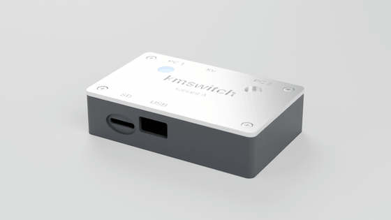
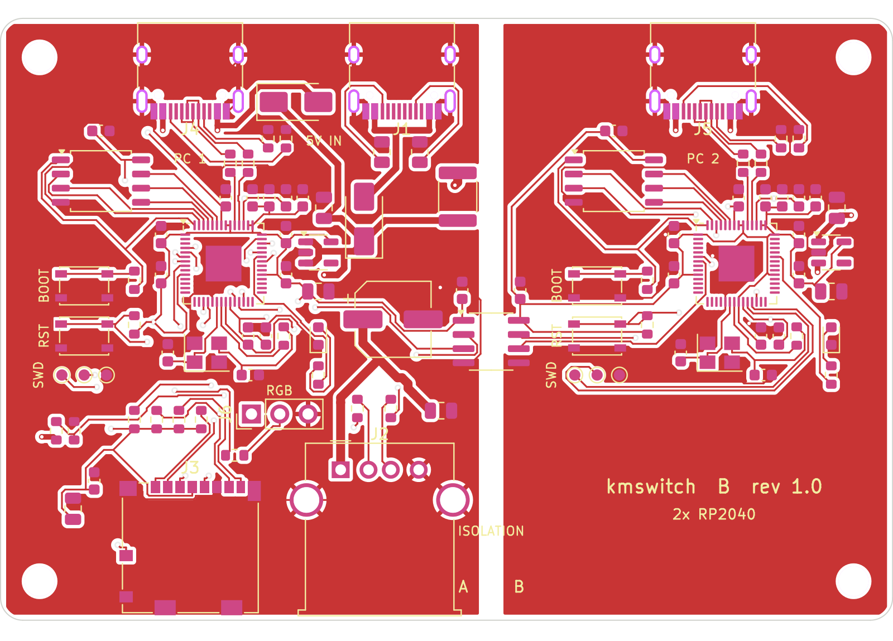
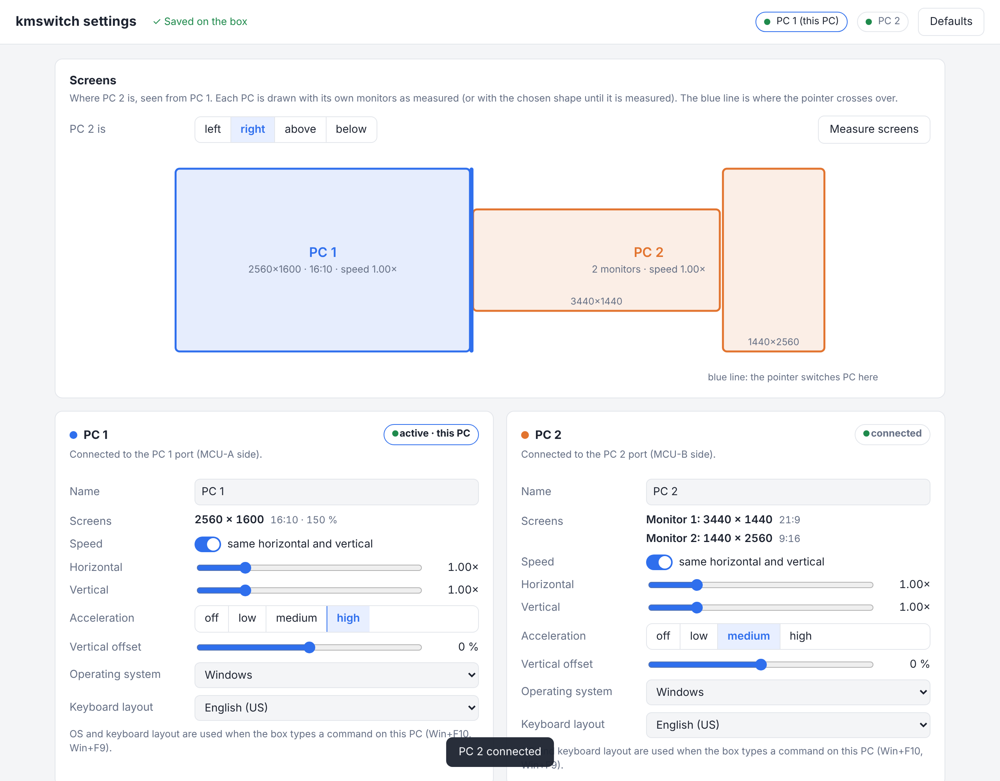
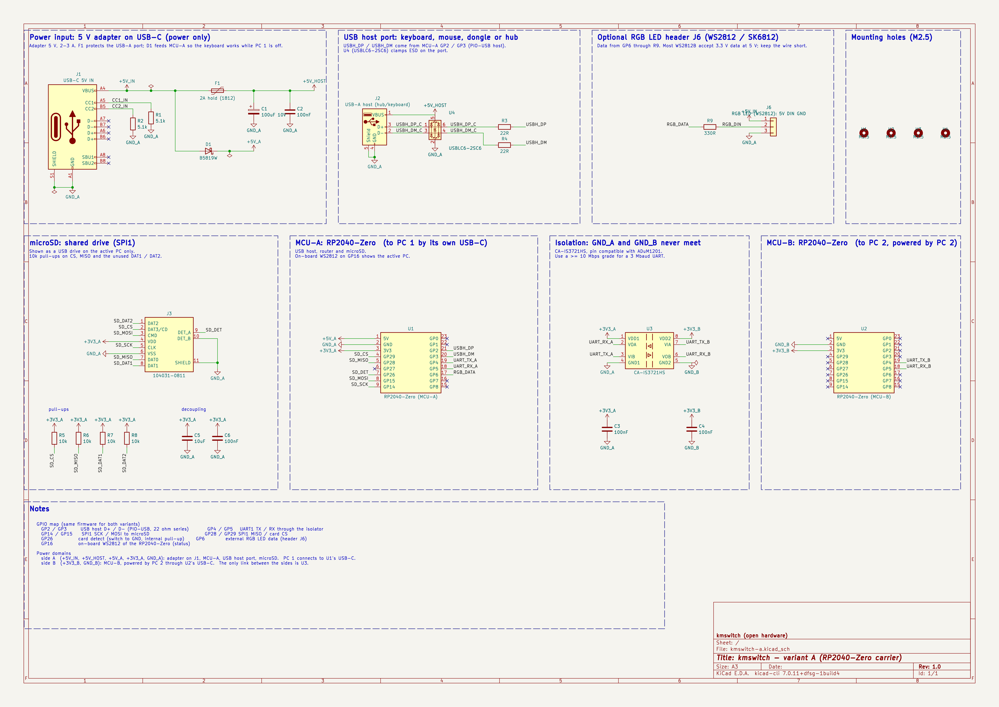
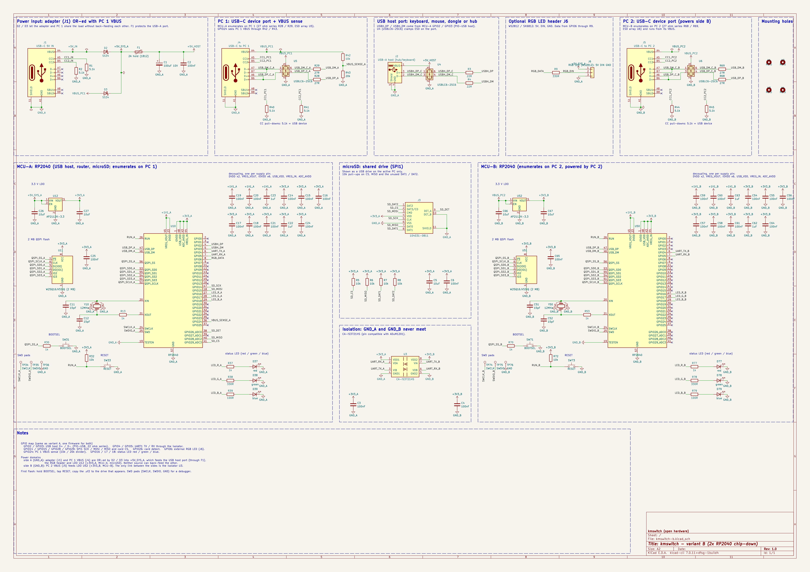
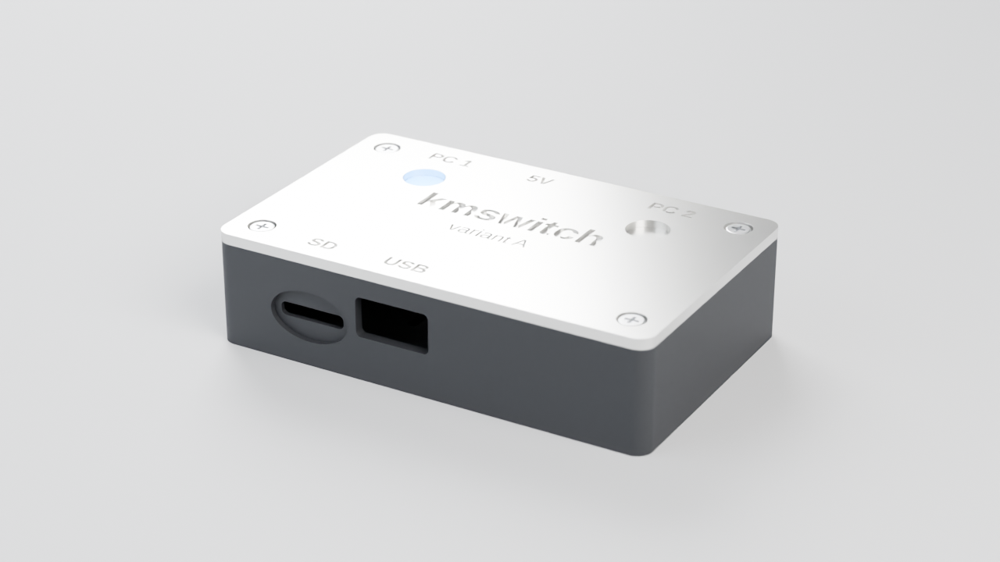

# kmswitch

<p align="center"></p>

[](https://ohwr.org/cern_ohl_p_v2.txt)
[](LICENSE)


**One keyboard and mouse for two computers.** A small open-hardware box that sits between your USB
keyboard/mouse (or a wireless dongle, or a hub) and two PCs. Switch with a hotkey, or just push the
mouse off the edge of one screen and it appears on the other. No software on either PC, works in the
BIOS, and the two PCs stay galvanically isolated.

| | |
|---|---|
| Switching | hotkey (default **Win+F12**) or moving the pointer across the screen edge |
| Host software | none: the PCs see a normal USB keyboard + mouse (+ a small USB drive) |
| BIOS / boot | yes: HID Boot Protocol keyboard and mouse |
| Input | one USB-A port for any keyboard, mouse or dongle; use a hub for several devices |
| Shared drive | microSD card, shown as a USB drive on whichever PC is active |
| Power | 5 V USB-C adapter (2-3 A), so the keyboard works even if PC 1 is off |
| Isolation | CA-IS3721 digital isolator: PC 1 and PC 2 grounds never touch |
| RGB LED (optional) | 3-pin header J6 (5V, DIN, GND) for a WS2812/SK6812 LED or strip, for your own case design |

> **Status:** hardware rev 1.0, not yet built or tested. The firmware is not written yet. See *Before you order* below.



## How it works

```
 keyboard / mouse / dongle / hub
              |
          [USB-A]
              |
   MCU-A (RP2040, USB host via PIO-USB) ---- USB device ----> PC 1
              |
       UART through CA-IS3721 isolator
              |
   MCU-B (RP2040) -------------------------- USB device ----> PC 2
```

- MCU-A reads your input devices as a USB host. It sends each report either to PC 1 directly or over the isolated UART to MCU-B, which sends it to PC 2.
- To each PC, its MCU looks like a plain USB keyboard + mouse (Boot Protocol), so it works in BIOS/UEFI, login screens and any OS, with no drivers.
- **Screen-edge switching:** the mouse is reported with absolute coordinates, so the box knows when the pointer reaches the edge and hands it over to the other PC.
- **Shared drive:** the microSD card appears as a USB drive on the active PC only. On a switch the drive is ejected and shown to the other PC (media change), so the file system is never mounted twice.

## Two board variants, one choice

Both variants have the same features, the same GPIO map (so one firmware fits both) and connectors in the same places.

| | **Variant A** - RP2040-Zero carrier | **Variant B** - 2x RP2040 chip-down |
|---|---|---|
| Folder | `hardware/variant-a-rp2040-zero` | `hardware/variant-b-rp2040` |
| Board | 80 x 48 mm, 2 layers | 80 x 54 mm, 2 layers |
| MCUs | two Waveshare RP2040-Zero modules on pin headers | two RP2040 + W25Q16 flash + 12 MHz crystal |
| Assembly | hand-solderable (0805, SOIC, SOD-123) | factory assembly (JLCPCB BOM + CPL included) |
| PC connections | USB-C on the modules | USB-C on the board |
| Powered without adapter | no | yes, from PC 1 (adapter and PC 1 are OR-ed by diodes) |
| Back-feed into a switched-off PC 1 | ~4.7 V can reach PC 1 VBUS through the module | none |
| Good for | building one at home | ordering a batch, smallest result |

## Configuration (optional)

It works without any setup. To tune the mouse for different screens, change the hotkeys or add a relative mode for games, press **Win+F10**: the box opens its own settings page (`http://192.168.7.1`, served by the box over a private USB network link, any browser, nothing installed). Changes are saved on the box by themselves, the page shows live which PC is connected, and the box measures each PC's monitors automatically (LEDs blink for a few seconds while it switches over and measures), including several monitors of different shape on one PC.
Where the USB network is not allowed, the same page works offline from the microSD card ([`config/KMSWITCH.HTM`](config/KMSWITCH.HTM)) together with the settings file [`config/KMSWITCH.TXT`](config/KMSWITCH.TXT).
Full reference: [docs/configuration.md](docs/configuration.md); page-to-box protocol: [docs/web-api.md](docs/web-api.md).

**Firmware updates** come from the same page (one click when a new release is out, confirmed with **Win+F8** on the box's own keyboard), from a file copied to the drive, or, as a last resort, through the RP2040's BOOTSEL mode. Updates are signed and roll back by themselves if the new version does not start: [docs/firmware-update.md](docs/firmware-update.md).



## Schematics

Each variant has one readable sheet, split into framed blocks (power input, USB ports, MCU, microSD, isolation, ...) with real wires inside each block, named power symbols (`+5V_IN`, `+3V3_A`, `GND_B`, ...) and net labels between blocks.
PDF: `hardware/<variant>/fab/kmswitch-<a|b>-schematic.pdf`. Vector versions that stay sharp at any zoom: [variant A (SVG)](docs/schematic-a.svg), [variant B (SVG)](docs/schematic-b.svg).

**Variant A** (A3 sheet), click for full size:

[](docs/schematic-a.png)

**Variant B** (A2 sheet), click for full size:

[](docs/schematic-b.png)

## Repository layout

```
hardware/
  lib/                         project symbols (RP2040-Zero, microSD), RP2040-Zero footprint,
                               3dmodels/ (detailed STEP models for parts that have none in the KiCad library)
  variant-a-rp2040-zero/       KiCad project + fab/ (gerbers zip, BOM, CPL, schematic PDF, renders)
  variant-b-rp2040/            KiCad project + fab/
config/
  KMSWITCH.TXT                 default settings file for the microSD card
  KMSWITCH.HTM                 settings page (served by the box, or offline from the card)
enclosure/
  kmswitch_case.scad           parametric 3D-printable case (variant = "A" or "B")
  stl/                         ready-to-print bottom + lid for both variants
firmware/                      (to come) firmware sources, latest.json and released update files
tools/                         Python scripts that generate the schematics, boards and outputs
docs/                          board and case renders, turntable animation, DRC reports
```

The KiCad files are saved by KiCad 7 and open in KiCad 7, 8 and 9 (newer versions convert them on save).

## Pin map (both variants)

| Function | MCU-A (host side, PC 1) | MCU-B (PC 2) |
|---|---|---|
| USB host D+ / D- (PIO-USB) | GP2 / GP3 (22 Ω series) | - |
| UART1 TX / RX (via isolator) | GP4 / GP5 | GP4 / GP5 |
| microSD SCK / MOSI / MISO / CS (SPI1) | GP14 / GP15 / GP28 / GP29 | - |
| microSD card detect | GP26 (switch to GND, use pull-up) | - |
| Status LED | GP16 WS2812 (A) / GP25 green LED (B) | same |
| PC 1 VBUS sense (B only) | GP24 (10k/20k divider) | - |
| External RGB LED data (header J6) | GP6 (330 Ω series) | - |

PIO-USB needs D- on the pin right after D+ and a system clock that is a multiple of 12 MHz (120 MHz works).

## Building

### Variant A (hand soldering)
1. Order the PCB with `fab/kmswitch-a-gerbers.zip` (2 layers, 1.6 mm, any colour).
2. Solder the SMD parts first (`fab/kmswitch-a-bom.csv`), then the USB-A socket.
3. Solder two 1x9 male headers per module into the carrier, put the RP2040-Zero modules on top and solder them.
   Only the two long rows are used; the five pads on the module's short edge stay free.
4. The modules' USB-C ports go to the PCs. The board's own USB-C is power only (5 V adapter).

### Variant B (factory assembly)
1. Upload `fab/kmswitch-b-gerbers.zip`, `fab/kmswitch-b-bom.csv` and `fab/kmswitch-b-cpl-jlcpcb.csv` to JLCPCB (or similar).
   Every assembled part has an LCSC / JLCPCB part number in the BOM (table in `tools/export.py`). Stock changes, so check them in the JLCPCB part search before ordering. Parts marked `n/a` are not on LCSC and are hand-soldered: the RP2040-Zero modules (variant A), the through-hole USB-A (Molex 67643-0910) and the optional RGB header J6.
2. Solder the USB-A socket yourself if your assembler does not place through-hole parts.
3. First flash: hold **BOOT**, tap **RST**, and drag the `.uf2` onto the drive that appears. SWD pads are next to the buttons.

### Optional RGB LED
Header **J6** (2.54 mm, labelled *RGB*): pin 1 = 5 V, pin 2 = data (GP6 of MCU-A through 330 Ω), pin 3 = GND.
Connect one WS2812B/SK6812 LED or a short chain, for example to light the side of the active PC or to glow through your own case.
Most WS2812B/SK6812 parts accept the 3.3 V data level at 5 V supply; keep the wire short (under ~20 cm). A short strip draws up to 60 mA per LED at full white, so stay within a few LEDs.
The header is not populated by the assembler; solder pins or a cable if you need it.

### Enclosure


Print `enclosure/stl/kmswitch-<a|b>-bottom.stl` and `-lid.stl` (PLA/PETG, 0.2 mm layers, no supports; the lid prints upside down).
Outside size: 85 x 53 x 21.6 mm (A) or 85 x 59 x 19.6 mm (B). Both parts together use about 35 g of filament and print in about 40 min on a fast printer (1 to 1.5 h on a Prusa MK3S / Ender 3).
Use white or translucent filament for the lid if you want the LEDs to shine through the thin windows.
Fix board and lid with four **M2.5 self-tapping screws**: 20 mm for variant A, 18 mm for variant B. They go through the lid posts and the board into the standoffs.
To change anything (wall thickness, port sizes, height), open `kmswitch_case.scad` in OpenSCAD and edit the parameters at the top.

## Before you order (please read)

- **RP2040-Zero footprint:** the header rows are drawn 15.24 mm apart with 2.54 mm pitch, pad 1 (5V) next to the USB-C.
  Measure your module or print `fab/kmswitch-a-front.png` at 1:1 and check before ordering.
- **Isolator speed:** CA-IS3721**HS** (or ADuM1201**B/C**) is fast enough for a 3 Mbaud UART. The plain ADuM1201**AR** is limited to about 1 Mbaud.
- **ERC:** KiCad 7's command line has no ERC, so the schematic was checked by comparing its netlist with the design scripts (0 differences).
  Run *Inspect → Electrical Rules Checker* once in KiCad; only "power pin not driven" style warnings should remain.
- **DRC:** both boards pass DRC with 0 errors and 0 unconnected pads, checked with KiCad 7. Two warning types are switched off on purpose: silkscreen on the board edge (connectors sit on the edge) and *footprint does not match library* (the 3D models were replaced with the ones in `hardware/lib/3dmodels`).
- The routing comes from an autorouter. It is electrically complete; tidying it by hand is welcome.

## Regenerating

```
cd tools
python3 make_lib.py           # project library
python3 sch_build.py a        # schematic only (layout in sch_a.py), checked against the design netlist
python3 build.py a            # schematic + board + autoroute (Freerouting) + DRC for variant A
python3 build.py b
python3 make_models3d.py     # build the detailed 3D models (CadQuery, STEP)
python3 make_models.py       # attach them to both boards
python3 export.py a           # gerbers, BOM, CPL, PDF, renders
openscad -D 'variant="A"' -D 'part="bottom"' -o ../enclosure/stl/kmswitch-a-bottom.stl ../enclosure/kmswitch_case.scad
```
Needs KiCad 7 with its Python module, Java, OpenSCAD and Freerouting 1.9 (put `freerouting.jar` in `tools/` or set `FREEROUTING_JAR`).
Routing runs Freerouting headless (`xvfb-run`); the result can differ slightly between runs.

## License

Hardware and enclosure: [CERN-OHL-P-2.0](https://ohwr.org/cern_ohl_p_v2.txt) (permissive). Scripts: MIT.
